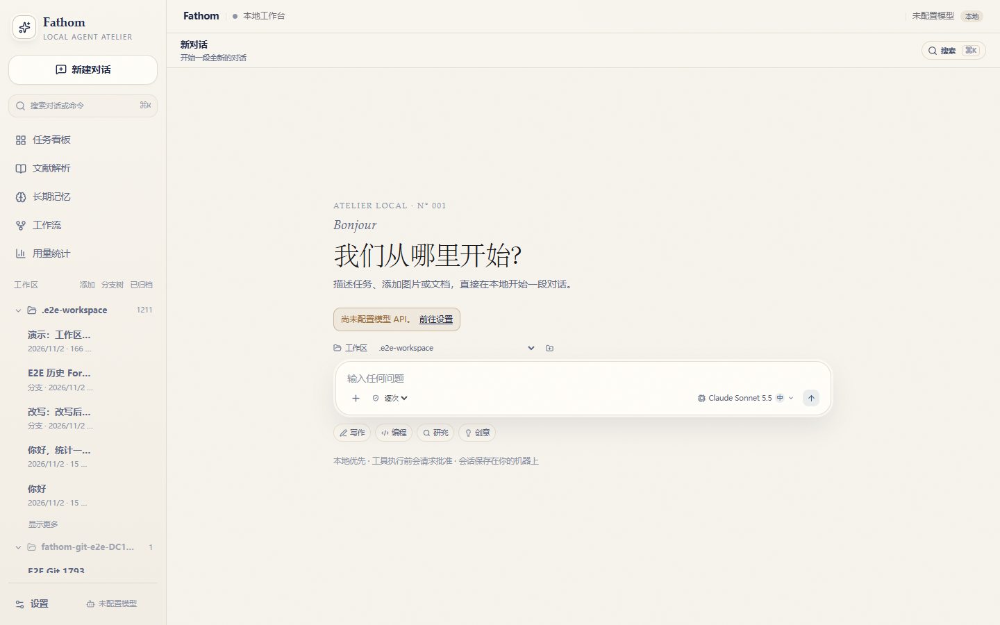

# Fathom

一个本地优先、可自己掌控的 Agent 工作台。目标不是复刻某个产品，而是用一套清晰的最小内核，
支撑出一条可以持续扩展到多 Agent、长期记忆、桌面端和文献分析的路线。

当前版本覆盖 **M0–M4 的最小闭环**：pi SDK 内核、流式对话、工具调用、人工审批、
事件持久化/回放、上下文压缩、运行中排队、Todos、文件 diff、自动重试、文献 PDF 解析、RAG，
以及多 Agent DAG 与用户自建任务看板。



## 现在能做什么

- **pi 执行内核**：Session 持久化、上下文压缩、follow-up 队列、steering、自动重试由 pi SDK 提供；daemon/Web 是我们的外壳。
- **流式对话**：pi-ai Provider 目录；可在客户端设置页选择 Provider、模型并填入自己的 API Key。
- **设置中心**：外观、主题与工具审批集中在独立设置页；模型与 API Key 只保存在本机，保存后不回显，新对话热切换模型。
- **模型选择**：Provider/模型目录、上下文与输出元数据、推理强度；首页与会话页可切换，活动 Run 禁止切换。默认模型持久化，新会话自动复制。
- **自定义 Provider**：OpenAI-compatible / Anthropic-compatible 端点、自定义 Base URL、模型列表与独立 API Key；与内置 Provider 一起出现在模型目录、连接测试和 ModelPicker。
- **Provider OAuth**：设置页列出支持 OAuth 的 Provider，处理授权链接/设备码/文本提示，登录与登出凭据交给 pi CredentialStore。
- **三档审批**：逐次审批 / 自动批准 / 完全访问；设置页、首页和会话页共用同一全局策略。
- **纸感界面**：奶白纸面、墨蓝文字、银蓝阴影、衬线标题、克制的纸纹与更安静的控件；保持键盘、窄屏和 reduced-motion 可用。
- **首屏输入**：首页直接使用 Hero Composer 发送第一条消息；快捷提示、图片与文档附件、Plan 开关无需先创建空会话。
- **多工作区**：工作区注册表、按工作区分组会话、折叠/每区 5 条分页、新建/重命名/排序/软移除；会话绑定稳定 `workspaceId`，旧会话启动时自动回填。
- **存储位置**：桌面客户端可自定义数据目录与缓存目录；数据目录在下次启动前复制迁移，迁移失败保留旧目录，安装器允许选择安装位置。
- **多模态输入**：支持图片附件（最多 4 张）、PDF/DOCX/PPTX/XLSX/文本文档附件与 `@` 工作区文件引用。
- **工具循环**：`list_files`、`read_file`、`search_text`、`write_file`、`edit_file`、`run_command`、`search_history`。
- **Web 与多模态工具**：`web_fetch`（SSRF/私网拒绝、重定向/超时/大小限制）、`web_search`（可配置 SearXNG）、`view_image`、`read_document`（PDF/DOCX/PPTX/XLSX）、`view_pdf_page`。
- **沙箱**：`off` / `read_only` / `workspace_write` Profile、域名 allow/deny、原子保存；沙箱拒绝后可按次请求宿主权限重跑。
- **工具守卫**：并发上限、单次超时、同参数副作用去重；后台命令支持 `wait_background_command` 等待结束。
- **Skills**：解析 `SKILL.md`，按 system → global → project 发现并同名覆盖，禁用后不回退；`find_skill` / `get_skill` / `load_skill` / `skill_creator` 按需加载正文与资源；设置页可启用/查看/从 GitHub 安装，Composer 输入 `$` 引用。
- **用量与 Trace**：从 JSONL 聚合主/子 Agent 与压缩请求的 token、请求数和费用估算，提供 365 天热力图/趋势/模型筛选；会话执行轨迹展示 Run、请求快照、工具、审批、压缩与子 Agent，提供输入/模型/工具三泳道时间轴、请求概要页签，可按 executionId 切换。
- **对话体验**：对话/轨迹/文件三视图，轮次导航、消息复制/编辑重发/重试/fork、思考面板、工具结果按需加载、文件 Inspector 与系统应用打开。
- **SRT 沙箱**：`@anthropic-ai/sandbox-runtime` 包装 `run_command`，按 Profile 限制文件与网络；并发串行持有全局代理，凭据环境变量可脱敏；不可用时明确失败。
- **持久与检索**：Session 消息 FTS5 索引（可重建）、中断 Run 的手动 Durable 续跑、OpenAI-compatible 语义 Embedding（可选，失败退化为 FTS）。
- **工作区上下文**：启动时读取 workspace 根目录的 `AGENTS.md`（16 KiB 上限）并注入主/子 Agent 系统提示；新顶层 Run 会清空上一 Run 的 Plan/Todos 投影，原始事件保留。
- **人工审批**：写文件、改文件、执行命令前暂停；支持逐次 / 自动 / 完全访问三档，审批卡展示风险、目标与影响并折叠原始参数；自动模式下的 Shell 由独立模型复核；支持持久化“允许类似命令”和本次会话授权。
- **HITL 提问**：Agent 可通过 `request_user_input` 发起单选/多选/自由输入提问；卡片分页、超时/中止收口，SSE 重连与 daemon 重启都会清理未决提问。
- **M2**：运行中排队消息、插话（steering）、计划模式（只读分析、硬阻断副作用工具、结构化计划、批准执行与自然语言多轮修订）、Todos 面板、文件变更 diff、上下文压缩、自动重试、token 用量展示。
- **上下文检查点**：每次压缩写入目标/约束/决策/完成/待办/阻塞/下一步，以及稳定版本 ID、上一版本与覆盖 seq；会话页可对比两版差异，并空闲时恢复检查点到下一次 Run。
- **历史与请求审计**：`search_history` 在完整 JSONL 中返回有界片段、可见消息序号与 seq；每次模型请求记录 system prompt、工具定义、消息数组与估算 token。
- **自动续轮**：显式要求自主迭代时，模型通过结束标记触发下一轮，由 pi 的 `agent_before_settle` 边界执行，最多 8 次（可配置），内部续轮消息写入事实源但不渲染。
- **改写与文件撤销**：从历史用户消息编辑并重跑会创建新分支；文件变更可基于 before/after 整体撤销/重放，冲突时整体拒绝。
- **M3**：文献章节识别、长文 map-reduce、引用校验、分析进度/取消、章节结构展示。
- **RAG 与长期记忆**：文献自动切块入库，SQLite FTS5（trigram）检索；长期记忆支持 CRUD、FTS + 本地哈希向量的 RRF 混合召回、请求级自动注入与注入标记，以及 `save/search/forget_memory` 工具。
- **多 Agent（M4）**：`spawn_agent` / `wait_agents` / `send_agent` / `stop_agent`，以及一次提交 DAG 的 `run_workflow`；
  依赖完成后自动调度、失败向下游传播；子 Agent 独立上下文/事件/审批，支持 token/时长/节点预算与 daemon 重启补偿；Web 提供看板、依赖图与列表三视图；工作流页可保存、复用，支持 cron/时区、Webhook、文件变更与条件触发，并直接运行 DAG、记录历史。
- **任务工作台**：会话搜索、重命名、归档恢复、任意历史消息 fork、分支父链/分支树/对比/三方代码合并、Git 面板、Electron 桌面客户端、命令面板（⌘/Ctrl K）、工作区文件树与文本编辑、后台命令管理、独立设置页（主题/审批/模型 API）。
- **任务看板**：用户创建顶层任务（待开始/执行中/需处理/待确认/已完成），启动后绑定 Session/Run；
  状态由运行事件派生（审批→需处理、Run 成功→待确认、手动确认→已完成），支持编辑、重试与工作区选择。
- **事件持久化**：每个 Session 一个 JSONL 事实源，SQLite 保存索引与设置；刷新/重启后可回放。
- **SSE**：先快照、再按 `seq` 重放、最后接收增量；快照包含未决审批与提问，断线重连不重复。
- **文献解析（M3）**：上传 PDF → 逐页抽取 → 章节识别 → 长文 map-reduce → 知识清单/技术路线/创新点/实验/局限；
  页码引用会做确定性校验（越界、证据原文匹配、置信标记），解析过程有阶段进度与取消；
  支持导出 Markdown / JSON / BibTeX。
- **本地安全边界**：只监听回环地址；路径 realpath + 受保护目录；所有变更请求要求同源 Origin + 自定义头。

## 快速开始

要求 Node.js 24+ 与 pnpm 10。

```bash
git clone https://github.com/Ricardu255/Fathom.git
cd Fathom
cp .env.example .env
pnpm install
pnpm dev
```

打开：

- Web: <http://127.0.0.1:5180>
- Daemon: <http://127.0.0.1:4311/api/health>

首次启动后进入 **设置 → 模型与 API**，选择 Provider 与模型并填写 API Key，保存后即可开始对话。
未配置模型时客户端仍可打开，但对话不会调用外部模型。

### 接入真实模型

在客户端左下角进入 **设置 → 模型与 API**：

1. 选择 Provider 与模型；
2. 粘贴 API Key；
3. 点击 **保存并应用**。

API Key 写入本机 `data/` 目录（设置数据库与 pi 凭据文件），接口只返回“是否已配置”和密钥来源，保存后不再回显。
新对话会立即使用新模型；已打开的对话及其子 Agent 保持原模型，避免中途切换上下文。
桌面客户端同样在设置页配置，不需要改环境变量或重启。

也可以继续用环境变量提供默认值（设置页保存的值优先）：

```bash
HARNESS_ANTHROPIC_API_KEY=sk-ant-...
HARNESS_MODEL=claude-sonnet-5-5
HARNESS_MAX_TOKENS=16000
```

### 生产模式

```bash
pnpm build
pnpm start
```

daemon 会同时托管 `apps/web/dist`，直接访问 <http://127.0.0.1:4311>。

## 常用命令

| 命令                               | 说明                                      |
| ---------------------------------- | ----------------------------------------- |
| `pnpm dev`                         | 并行启动 daemon（tsx watch）与 Vite       |
| `pnpm dev:daemon` / `pnpm dev:web` | 单独启动                                  |
| `pnpm build`                       | 构建 daemon 与 Web                        |
| `pnpm start`                       | 运行已构建产物，daemon 托管 Web           |
| `pnpm typecheck`                   | 全 workspace TypeScript 检查              |
| `pnpm test`                        | Node 内置测试：策略、事件存储、Agent 循环 |
| `pnpm test:e2e`                    | 构建后运行 Playwright Web/API 冒烟测试    |
| `pnpm desktop:dev`                 | 构建并启动 Electron 桌面客户端            |
| `pnpm desktop:package`             | 构建 Electron 安装包                      |
| `pnpm test:desktop`                | 构建并运行 Electron 客户端 E2E            |
| `pnpm check`                       | Biome lint + format                       |

## 目录结构

```text
agent-harness/
├── apps/
│   ├── daemon/                # HTTP/SSE、SQLite、JSONL、审批、文献
│   └── web/                   # React + TanStack Query + Zustand
├── packages/
│   ├── core/                  # 事件协议、消息/工具契约（旧自建循环仍保留）
│   ├── providers/             # 文献模块使用的 Anthropic 客户端
│   ├── tools/                 # 文件/搜索/命令/Web/图片/文档工具
│   ├── sandbox/               # 沙箱 Profile 与域名边界
│   └── policy/                # 路径与命令策略
├── docs/
│   ├── architecture.md        # 分层、事件协议、安全红线、扩展点
│   ├── pi-migration.md        # 为什么/如何改用 pi SDK 内核
│   ├── rag-and-multi-agent.md # RAG 与多 Agent 设计
│   ├── testing.md             # 测试清单与原则
│   ├── implementation-checklist.md # 参考项目对齐与逐项实施清单
│   ├── adoption-plan.md       # 参考项目采纳/排除清单与优先级
│   ├── roadmap.md             # M2–M5：上下文、RAG、多 Agent、桌面端
│   └── literature-module.md   # 文献解析管线与升级路线
└── data/                      # 运行时生成：SQLite、JSONL、文献
```

## 测试覆盖（262 项单元/集成 + 42 项浏览器 E2E + 1 项 Electron E2E）

- **核心 M2**（`packages/core/test/m2.test.ts`）：运行中排队、工具结果投影、自动重试、上下文压缩、Abort 清队列。
- **pi 引擎集成**（`apps/daemon/test/pi-engine.test.ts`）：真实 pi Session + 本地测试模型，覆盖工具循环、审批写文件、follow-up 队列、Todos、事件 seq。
- **HITL**（`apps/daemon/test/user-input.test.ts`、`session-recovery.test.ts`）：提问请求/解决/过期、并发、超时、Abort、取消、子 Agent 归属与重启收口。
- **上下文检查点**（`apps/daemon/test/context-checkpoint.test.ts`、`pi-engine.test.ts`）：结构化派生、摘要分节、版本链、字段对比、恢复事件与下一次 Run 注入。
- **Context 与历史**：请求快照、历史检索、工具调用组不拆分、超窗错误、自动续轮标记与内部消息隐藏。
- **改写与文件撤销**：历史消息改写分支、before/after 撤销/重放、多文件冲突整体拒绝。
- **工具与沙箱**：SSRF/重定向/超时、SearXNG 检索、图片与文档读取、PDF 渲染错误路径、工具守卫、Profile/域名边界与宿主重跑审批。
- **Skills**：frontmatter 解析、scope 覆盖/禁用不回退、正文与资源加载、skill_creator、GitHub 安装校验与复制限制。
- **用量与 Trace**：主/子 Agent 用量聚合、费用估算、Run/Request/Tool/Approval/消息/压缩/子 Agent 投影与失败终态；泳道使用同一 JSONL 投影。
- **对话与沙箱**：三视图切换、消息操作、轮次导航、思考面板、工具结果按需加载、文件 Inspector；SRT 配置、Session FTS、Durable 续跑与 HTTP Embedding。
- **Web store**（`apps/web/test/chat-store.test.ts`）：快照 hydrate、seq 去重、文件变更、Todos、排队项、压缩计数、失败清态。
- **文献 M3**（`apps/daemon/test/literature-*.test.ts`）：章节/切块、长文分块、引用校验、map-reduce、进度与取消。
- **RAG 与记忆**：索引/替换/删除、中英文 FTS、短查询回退、memory CRUD、本地向量 RRF、search/save/forget 工具。
- **多 Agent**：子 Agent 投影、控制工具、服务级 spawn/stop、DAG 依赖调度、预算配置、重启恢复补偿。
- **任务看板**：任务 CRUD 与校验、启动/重启、事件派生状态、审批等待、确认完成、工作区去重。
- **工作台**：多审批槽位、会话搜索/归档恢复/历史消息 fork/分支树、工作流保存/定时/历史、计划模式/计划批准、文档附件、工作区编辑、后台命令、Git、文献 Markdown/JSON/BibTeX 导出、图片消息内容块、@ 文件列表、设置页主题/审批/模型 API 与密钥不回显。
- **桌面客户端**：Electron 壳、动态本地端口、daemon sidecar、集成状态栏与亮色主题；`pnpm desktop:dev` 启动，`pnpm desktop:package` 打包。
- **E2E**：42 项浏览器流程 + 1 项 Electron 客户端启动/状态栏/存储设置检查。
- **基础边界**：路径策略、命令判定、JSONL 写入/重放/末行修复。

所有测试都使用临时目录，不触碰真实 `data/`，也不调用外部模型。

详细测试清单见 [docs/testing.md](docs/testing.md)。

## 设计原则

1. **Agent 循环自己拥有**。事件、取消、审批、工具调度都在 `packages/core`，不依赖框架黑盒。
2. **JSONL 是事实源**。SQLite 只做索引与设置；事件先追加文件，再更新索引。
3. **审批是协议，不是 UI 特例**。运行时发出 `approval.requested`，HTTP 解析后发回 `approval.resolved`。
4. **路径与命令先过策略**。所有文件工具使用 realpath 后的绝对路径；命令默认逐次审批。
5. **不重复参考项目的已知坑**。例如：不用 URL 前缀做鉴权、事件队列吞掉 rejection、外部写事件不同步 seq、
   读取时 truncate JSONL、每个后台 Session 各开一条 SSE、每个 token 触发整页重渲染。
   详见 `docs/architecture.md` 的“安全与可靠性红线”。

## 已知边界（M1）

- 单用户、本地回环；没有账号体系。不要直接暴露到局域网或公网。
- 已支持图片/PDF/DOCX/PPTX/XLSX 附件、steering、最新状态/历史消息 fork、分支树导航与分支对比/摘要合并、可保存/复用的工作流编辑器，以及定时/Webhook/文件变更触发；还没有复杂条件表达式与 MCP。
- `view_pdf_page` 的渲染依赖运行环境安装 `@napi-rs/canvas`；未安装时工具会返回可操作错误。
- SRT 沙箱需要系统安装/初始化 `@anthropic-ai/sandbox-runtime`（Windows 需要 SRT 账户与 WFP 初始化）；不可用时命令明确失败，不静默降级。凭据目前以环境变量 mask 方式脱敏，尚未实现请求头注入代理。
- Durable 续跑是“重建提示后手动继续”，不是崩溃后自动原地恢复；工具副作用不会被重放。
- Memory 语义检索使用可配置的 OpenAI-compatible Embedding；未配置时仍使用本地字符 n-gram 哈希向量。
- RAG 使用 FTS + 本地字符 n-gram 哈希向量的 RRF；还不是语义 embedding，评测集待做。
- 多 Agent 已有 DAG、token/时长/节点预算与重启补偿；还没有工作流可视化编辑器、嵌套子 Agent 与失败节点自动重试。
- 任务看板目前是单机全量列表，没有拖拽排序、跨项目筛选或自动触发器。
- 长期记忆已支持文本 CRUD、混合召回、自动注入与注入标记；workspace 文档入库与更细的引用卡片仍待做。
- 没有 MCP（按当前决定后置）；工具协议已抽象，后续可作为独立包接入。
- Skills 已支持本地目录与 GitHub 安装；插件 manifest、市场、OAuth Gateway 与插件内 MCP App 尚未实现。Composer `$skill` 目前以文本引用 + 隐藏上下文注入实现，没有独立标签 chip。
- pi 引擎默认关闭外部扩展/Skill 自动加载，只使用我们的工具与系统提示。
- 审批等待保存在内存；daemon 重启会把未决审批标记为拒绝、未完成 Run 标记为中断，不能原地续跑。
- 沙箱 Profile 下后台命令会被明确拒绝（长驻 SRT 进程尚未接入 worker 隔离），不会静默降级到宿主；宿主后台命令使用环境变量白名单、并发上限与独立 watchdog。
- Web 开发模式与桌面客户端各自使用独立数据目录（浏览器是仓库 `data/`，桌面端默认是 `%APPDATA%\Fathom\data`）；两者不要同时对同一目录启动 daemon。
- 文献解析已支持 60k 单次阈值、约 18k 切块、最多 16 块的 map-reduce；仍缺 OCR、图表/表格抽取与跨文献综述。
